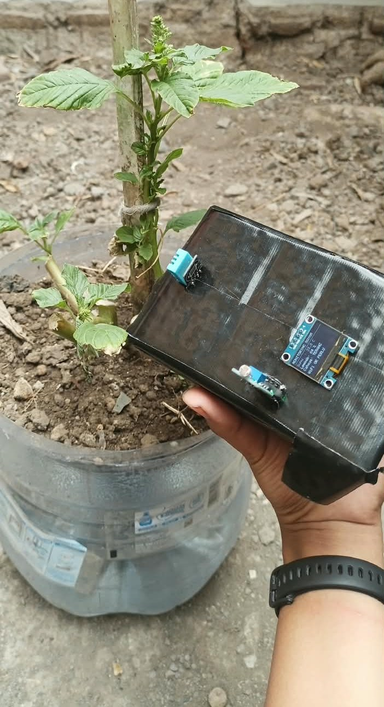
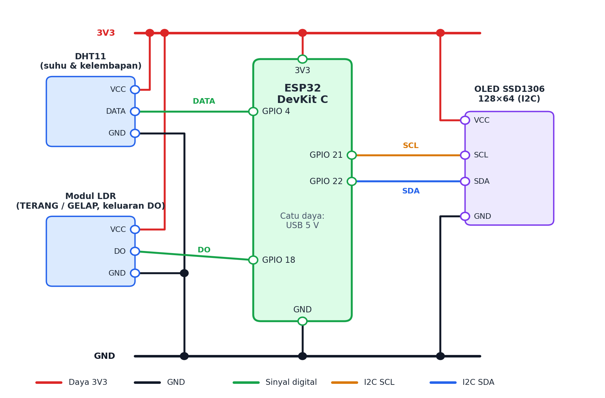
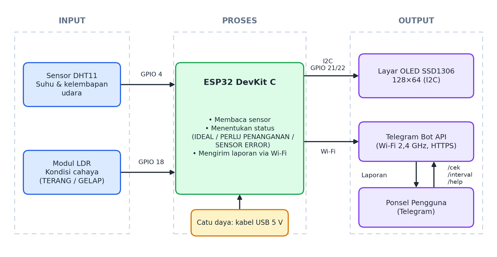
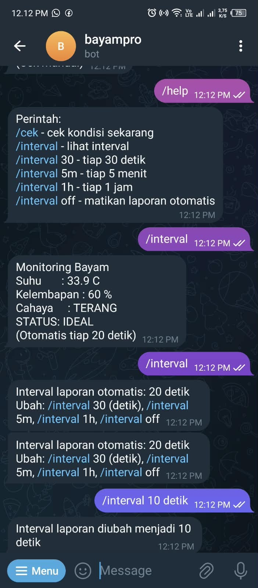
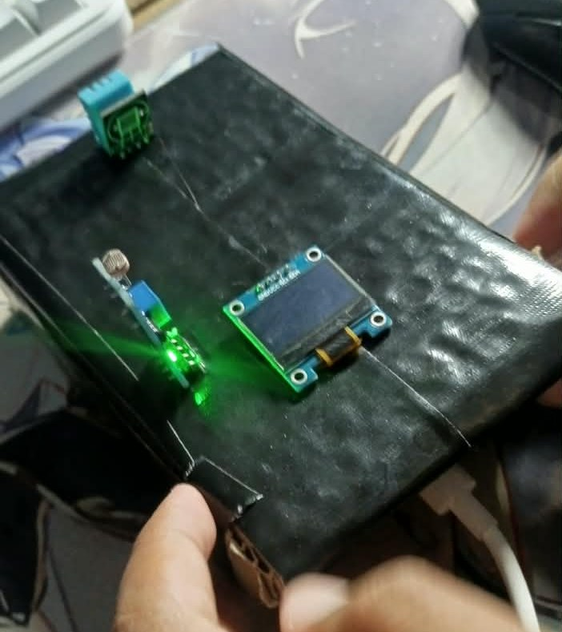
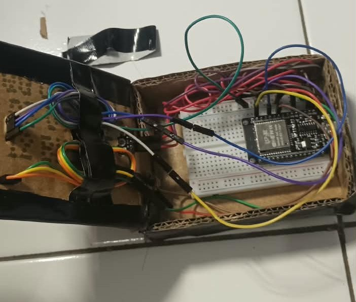

# 🌱 Sistem Monitoring Kondisi Tanaman Bayam Berbasis IoT

Perangkat IoT berbasis **ESP32** yang memantau **suhu**, **kelembapan udara**, dan **kondisi cahaya** di sekitar tanaman bayam liar. Hasil pembacaan ditampilkan pada layar **OLED** dan dikirim ke **Telegram Bot**, sehingga kondisi tanaman bisa dipantau dari ponsel.

> Proyek kelompok untuk Ujian Akhir Semester (UAS) mata kuliah **Pengantar Internet of Things (IoT)**, TA 2026/2027.

<p align="center">
  
</p>

## ✨ Fitur

- Membaca suhu dan kelembapan udara dari **DHT11** (1× per siklus, tiap 2,5 detik).
- Membaca kondisi cahaya dari **modul LDR** (keluaran digital DO) dengan **voting 15 kali**: hasilnya TERANG atau GELAP, sehingga tahan terhadap gangguan sesaat.
- Menentukan status **IDEAL**, **PERLU PENANGANAN** (beserta penyebabnya), atau **SENSOR ERROR**.
- Menampilkan data pada **layar OLED SSD1306 128×64** (I2C, alamat 0x3C/0x3D dipindai otomatis; tetap jalan tanpa layar bila tidak ditemukan).
- Laporan otomatis ke **Telegram Bot** dengan interval yang bisa diubah dari Telegram dan disimpan di memori flash.
- Perintah bot: `/cek`, `/interval`, `/help`.
- Hanya merespons perintah dari **chat ID yang terdaftar**.

## 🧰 Komponen

| No | Komponen | Fungsi |
| --- | --- | --- |
| 1 | ESP32 DevKit C | Mikrokontroler, Wi-Fi 2,4 GHz |
| 2 | Sensor DHT11 | Suhu dan kelembapan udara |
| 3 | Modul LDR (output digital DO) | Kondisi cahaya TERANG/GELAP |
| 4 | OLED SSD1306 128×64 (I2C) | Tampilan data di perangkat |
| 5 | Breadboard + kabel jumper | Perakitan rangkaian |
| 6 | Kotak kardus berlapis lakban hitam | Wadah perangkat |
| 7 | Kabel USB | Catu daya 5 V dan upload program |
| 8 | Telegram Bot (BotFather) | Antarmuka pemantauan jarak jauh |

## 🔌 Pengkabelan

| Komponen | Pin komponen | Pin ESP32 |
| --- | --- | --- |
| DHT11 | DATA | GPIO 4 |
| Modul LDR | DO | GPIO 18 |
| OLED SSD1306 | SDA | GPIO 22 |
| OLED SSD1306 | SCL | GPIO 21 |
| Semua modul | VCC | 3V3 |
| Semua modul | GND | GND |



> **Catatan:** keluaran analog (AO) LDR tidak dipakai karena saat Wi-Fi aktif ESP32 hanya bisa membaca analog di ADC1 (GPIO 32–39), sedangkan ADC2 tidak bisa dipakai bersamaan dengan Wi-Fi.

## 📐 Arsitektur dan Alur Kerja



Alur ringkas: **Inisialisasi** → **Baca sensor** (DHT11 + LDR voting 15×) → **Tentukan status** → **Tampil di OLED / kirim ke Telegram** → **ulangi**. Alur lengkap ada pada [flowchart](docs/images/flowchart.png).

## 📊 Kriteria Status

Rentang suhu memakai 25–35 °C karena objeknya bayam **liar** yang lebih toleran panas dibanding bayam budidaya (25–30 °C).

| Kondisi | Status | Keterangan |
| --- | --- | --- |
| Suhu > 35 °C | PERLU PENANGANAN | Terlalu panas |
| Suhu < 25 °C | PERLU PENANGANAN | Terlalu dingin |
| Kelembapan < 60 % | PERLU PENANGANAN | Kelembapan rendah |
| Cahaya GELAP | PERLU PENANGANAN | Terlalu gelap |
| Suhu 25–35 °C, kelembapan ≥ 60 %, cahaya TERANG | **IDEAL** | Kondisi sesuai |
| DHT11 gagal dibaca (NaN) | SENSOR ERROR | Cek kabel DHT |

Bila beberapa kriteria gagal sekaligus, semua penyebab dicantumkan, misalnya `PERLU PENANGANAN (terlalu gelap, terlalu panas)`.

## 🤖 Perintah Telegram

| Perintah | Fungsi |
| --- | --- |
| `/cek` | Baca sensor sekarang dan kirim laporan (bertanda *Cek manual*) |
| `/interval` | Lihat interval laporan otomatis saat ini |
| `/interval 30` | Laporan tiap 30 detik |
| `/interval 5m` / `/interval 1h` | Laporan tiap 5 menit / 1 jam |
| `/interval off` | Matikan laporan otomatis |
| `/help` | Tampilkan daftar perintah |

Interval yang valid: 5 detik sampai 24 jam (bawaan 10 detik). Perintah dicek tiap 5 detik, jadi balasan bisa tertunda sekitar 5 detik.

<p align="center">
  
</p>

## 🚀 Cara Menjalankan

### 1. Persiapan Telegram Bot

1. Buka [@BotFather](https://t.me/BotFather), kirim `/newbot`, lalu simpan **token** bot.
2. Kirim satu pesan apa saja ke bot kamu.
3. Ambil **chat ID** lewat [@userinfobot](https://t.me/userinfobot), atau buka `https://api.telegram.org/bot<TOKEN>/getUpdates` dan cari `"chat":{"id":...}`.

### 2. Clone dan atur kredensial

```bash
git clone https://github.com/<username>/<nama-repo>.git
cd <nama-repo>
cp include/secrets.h.example include/secrets.h
```

Edit `include/secrets.h`, isi `WIFI_SSID`, `WIFI_PASS`, `BOT_TOKEN`, dan `CHAT_ID`. File ini sudah masuk `.gitignore` sehingga **tidak akan ter-commit**. Wi-Fi harus **2,4 GHz**.

### 3. Build dan upload dengan PlatformIO

Instal [PlatformIO](https://platformio.org/) (ekstensi VS Code atau CLI), lalu:

```bash
pio run -t upload     # build + upload ke ESP32
pio device monitor    # Serial Monitor, 115200 baud
```

Library (`Adafruit SSD1306`, `Adafruit GFX Library`, `DHT sensor library`, `Adafruit Unified Sensor`) akan terunduh otomatis dari `platformio.ini`.

### 4. Kalibrasi polaritas LDR

Jika hasil TERANG/GELAP terbalik, ubah `DO_HIGH_GELAP` di `src/main.cpp` dari `true` menjadi `false`. Sensitivitas modul bisa diatur dengan potensiometer di modul LDR.

## 🧪 Hasil Pengujian

| Pengujian | Hasil |
| --- | --- |
| Fungsional komponen (5 komponen) | 5/5 berhasil |
| Kesesuaian program dengan flowchart | 5/5 langkah sesuai |
| Blackbox sistem | 13/13 skenario lulus |
| Akurasi DHT11 vs termohigrometer HTC-2 (dalam ruangan) | Selisih suhu 0,7 °C, RH 1 % |
| Uji pada tanaman bayam (6 kondisi) | Seluruh laporan Telegram diterima |

Hasil uji pada tanaman bayam liar:

| Waktu | Suhu (°C) | RH (%) | Cahaya | Status |
| --- | --- | --- | --- | --- |
| 05.57 | 28,9 | 76 | TERANG | IDEAL |
| 12.05 | 32,8 | 68 | TERANG | IDEAL |
| 14.46 (mendung) | 33,3 | 66 | GELAP | PERLU PENANGANAN (terlalu gelap) |
| 17.22 | 32,8 | 65 | GELAP | PERLU PENANGANAN (terlalu gelap) |
| 18.49 | 30,8 | 71 | GELAP | PERLU PENANGANAN (terlalu gelap) |
| 19.15 | 29,8 | 73 | GELAP | PERLU PENANGANAN (terlalu gelap) |

## 🖼️ Dokumentasi Perangkat

| Tampak luar | Bagian dalam |
| --- | --- |
|  |  |

## ⚠️ Keterbatasan

- Hanya memantau kelembapan **udara**, belum kelembapan media tanam.
- Cahaya hanya TERANG/GELAP (output digital), intensitas tidak terukur bertahap.
- Akurasi DHT11 baru diuji pada satu kondisi di dalam ruangan; uji tanaman sekitar satu menit per kondisi.
- Bergantung pada Wi-Fi 2,4 GHz; wadah kardus belum diuji terhadap air dan panas.
- Sertifikat server Telegram tidak diverifikasi (`setInsecure()`), cukup untuk keperluan tugas tetapi tidak disarankan untuk produksi.

## 🔭 Rencana Pengembangan

- Tambah sensor kelembapan tanah kapasitif.
- Ganti LDR digital dengan **BH1750** (I2C) agar intensitas cahaya terukur.
- Naikkan ke DHT22 atau SHT31 untuk akurasi lebih baik.
- Simpan riwayat data (Google Sheets / ThingSpeak) dan kirim laporan saat status berubah.
- Wadah tahan air dan panas, serta tambahan aktuator penyiraman dan pencahayaan.

## 📁 Struktur Repositori

```
.
├── src/
│   └── main.cpp                 # Program utama ESP32
├── include/
│   └── secrets.h.example        # Template kredensial (salin ke secrets.h)
├── docs/
│   └── images/                  # Diagram, skema, dan foto perangkat
├── platformio.ini
├── .gitignore
└── README.md
```

## 📚 Referensi

- Irawan, N. D., dkk. (2023). *Smart Hidroponik Berbasis IoT untuk Efektifitas Pertumbuhan Tanaman Bayam Hijau*. Jurnal Terapan Sains dan Teknologi, 5(2), 145–152.
- Al Huda, M. R., dkk. (2025). *Sistem Pengontrolan pH serta Kelembapan Tanah pada Tanaman Bayam Menggunakan Kontrol Logika Fuzzy*. Seminar Nasional Teknik Elektro, 4(1), 296–308.
- [ESP32 Series Datasheet](https://documentation.espressif.com/esp32_datasheet_en.html), Espressif Systems.
- [Telegram Bot API](https://core.telegram.org/bots/api).
